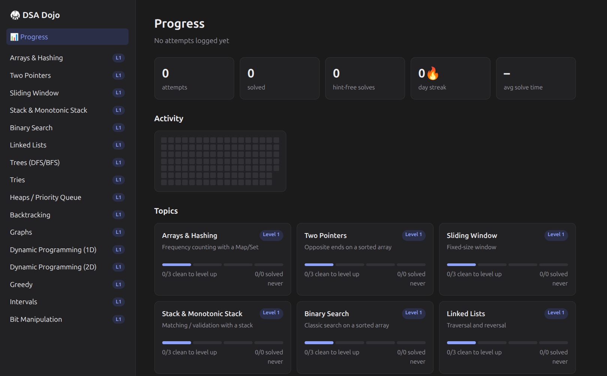

# 🥋 DSA Dojo

A place to practise data structures and algorithms (DSA) a little every day, in TypeScript, to get ready for coding interviews.

It works like [Kumon](https://en.wikipedia.org/wiki/Kumon): small problems, done often, that get harder as you improve. Claude makes each problem for you. You write the solution, the tests check it, and your progress is saved.



## What's in this repo

| Folder / file | What it is |
|---|---|
| [`problems/`](problems/) | The problems, one folder per topic (16 topics), each split into `level-1` to `level-4` |
| [`ui/`](ui/index.html) | A small web page to read problems and see your progress |
| [`dojo/`](dojo/) | The tooling. You rarely need to open it |
| [`dojo/lib/topics.ts`](dojo/lib/topics.ts) | The list of topics and what each level means |
| [`dojo/progress/log.json`](dojo/progress/log.json) | Your saved attempts |
| `dojo/.reference/` | Model solutions (spoilers!) |
| [`CLAUDE.md`](CLAUDE.md) | Instructions Claude follows to make and check problems |

Each problem folder has 4 files:

- `problem.md`: the task, examples, limits and 2 hidden hints
- `solution.ts`: where you write your code
- `solution.test.ts`: the tests (5–10, including a large input that catches slow solutions)
- `meta.json`: topic, level, title and date


## How to use it each day

1. **See what to practise.**
   ```bash
   npm run today
   ```
2. **Get a problem.** Open Claude Code in this folder and ask:
   > give me today's problem

   You can also ask for a topic or level, like "new sliding-window problem" or "next two-pointers, level 2".
3. **Solve it.** Read `problem.md` and write your code in `solution.ts`. Keep the tests running while you work:
   ```bash
   npm run practice
   ```
4. **Save your attempt.** This runs the tests itself, so the result is always honest:
   ```bash
   npm run log -- two-pointers/001 --mins 18 --hints 1 --notes "forgot duplicates"
   ```
5. **Get feedback (optional).** Ask Claude to "review my solution".

To read problems and see your progress in the browser, run `npm run ui` and open <http://localhost:4321>.

## Levels

Every topic has 4 levels:

1. **Bare pattern:** the textbook version of the technique.
2. **Variation:** the same idea with a twist.
3. **Recognition:** you must spot which technique fits.
4. **Disguised or combined:** interview-hard, sometimes mixing two techniques.

**Solve 3 problems at a level without hints to move up.** A failed attempt is fine to log. It does not count against you.

## Commands

| Command | What it does |
|---|---|
| `npm run today` | Shows what to practise today |
| `npm run stats` | Shows every topic and your last 10 attempts |
| `npm run practice` | Runs the tests again each time you save |
| `npm run log -- <topic>/<num> [--mins N] [--hints N] [--notes "..."]` | Runs a problem's tests and saves the attempt |
| `npm run ui` | Opens the web page at <http://localhost:4321> |
| `npm run typecheck` | Checks all the TypeScript types |

## Topics

Arrays & Hashing · Two Pointers · Sliding Window · Stack · Binary Search · Linked Lists · Trees · Tries · Heaps · Backtracking · Graphs · 1D Dynamic Programming · 2D Dynamic Programming · Greedy · Intervals · Bit Manipulation
